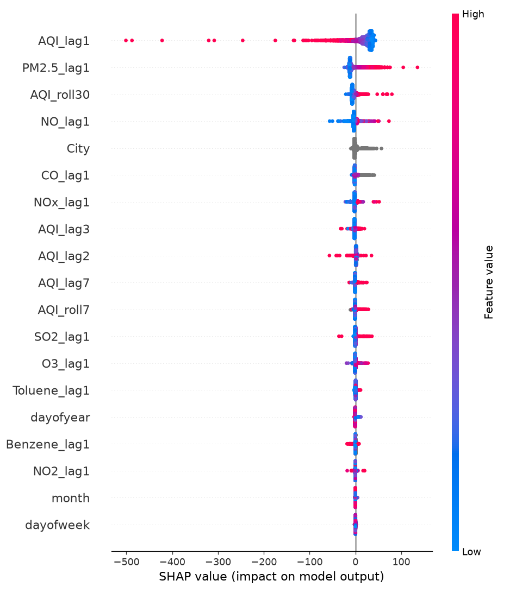
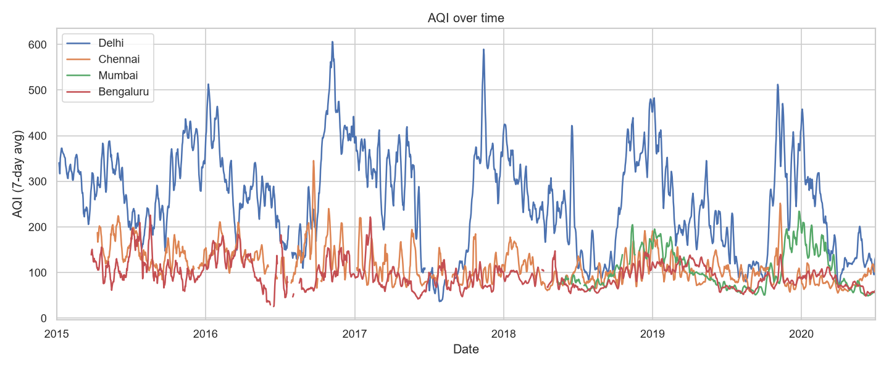
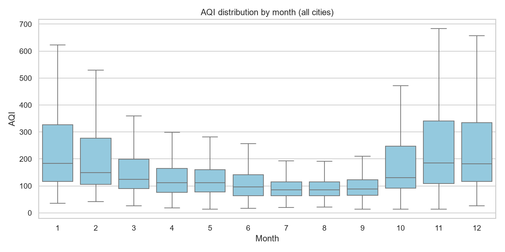

# Next-Day AQI Forecasting for Indian Cities

Live demo: https://india-aqi-forecasting.streamlit.app/

Forecasts the next day's Air Quality Index (AQI) for 18 Indian cities using 5 years of Central Pollution Control Board (CPCB) data, and analyses how the model held up when the COVID-19 lockdown abruptly changed pollution levels in 2020.

## Data

[Air Quality Data in India (2015–2020)](https://www.kaggle.com/datasets/rohanrao/air-quality-data-in-india), daily city-level file `city_day.csv`. Not included in this repo; download it from Kaggle and place it in `data/`.

Cleaning decisions:
- Kept the 18 cities with at least 500 days of recorded AQI (about 1.5 seasonal cycles).
- Dropped Xylene, PM10 and NH3 (35–61% missing) and AQI_Bucket (redundant with AQI).
- Found that 94% of Ahmedabad's CO readings were exact copies of its NO readings, a data entry error in the source, and masked them as missing.

## Approach

- **Target:** AQI on day *d*, using only information available by the end of day *d−1*. Same-day pollutant readings are excluded, since AQI is calculated directly from them (target leakage).
- **Features:** AQI lags (1, 2, 3, 7 days), previous-day pollutant readings, 7- and 30-day rolling AQI averages (shifted to exclude the current day), calendar features, and city.
- **Split by time, not randomly:** train 2015–2018, validation 2019, test 2020 (Jan–Jul, including the lockdown).
- **Baseline:** persistence (tomorrow = today).
- **Models:** LightGBM predicting the AQI level directly, and LightGBM predicting the *change* from yesterday (final prediction = yesterday's AQI + predicted change).

## Results (2020 test set)

| Model | MAE | RMSE |
|---|---|---|
| Persistence baseline | 21.63 | 45.94 |
| LightGBM (level) | 21.96 | 40.37 |
| **LightGBM (change)** | **19.70** | **39.97** |

The final model reduces MAE by **8.9%** and RMSE by **13.0%** compared with the persistence baseline.

### Distribution shift: the 2020 lockdown

| Period | Baseline MAE | Level model MAE (bias) | Change model MAE (bias) |
|---|---|---|---|
| Pre-lockdown (Jan 1 – Mar 24) | 31.85 | 28.95 (+8.2) | 28.11 (+7.2) |
| Lockdown (Mar 25 onward) | 12.88 | 15.98 (+9.0) | 12.50 (+3.5) |

The level model learned typical seasonal levels from 2015–2018 and kept predicting toward them after the lockdown sharply reduced pollution. It ended up **24% worse than the naive baseline** during the lockdown. Predicting the change instead anchors each forecast to the latest observation. This reduced the lockdown bias from +9.0 to +3.5 AQI and recovered a win over the baseline.

The change-based approach was also checked on 2019 validation data (MAE 26.75 vs 27.82 for the level model), so the choice doesn't rest on the test set alone.

## Interpretability



- **AQI_lag1** dominates. High values push predictions down: extreme pollution days tend to revert.
- **PM2.5_lag1** high values push predictions up: particulate build-up signals worsening air.
- Calendar features contribute very little in the change model, which explains its robustness to the 2020 shift.

## Exploratory analysis




AQI follows a strong yearly cycle. The median is about 185 in November–January and about 85 in July–August, driven by winter inversions, crop-stubble burning and Diwali, while the monsoon washes pollution out of the air.

## Run it yourself

```
pip install -r requirements.txt
python src/prepare.py
python src/train.py
streamlit run app/app.py
```

## Project structure

```
src/eda.py        exploratory analysis and plots
src/prepare.py    cleaning and feature engineering
src/train.py      baseline, models, evaluation, SHAP
app/app.py        Streamlit results explorer
outputs/          saved plots
models/           trained model
```